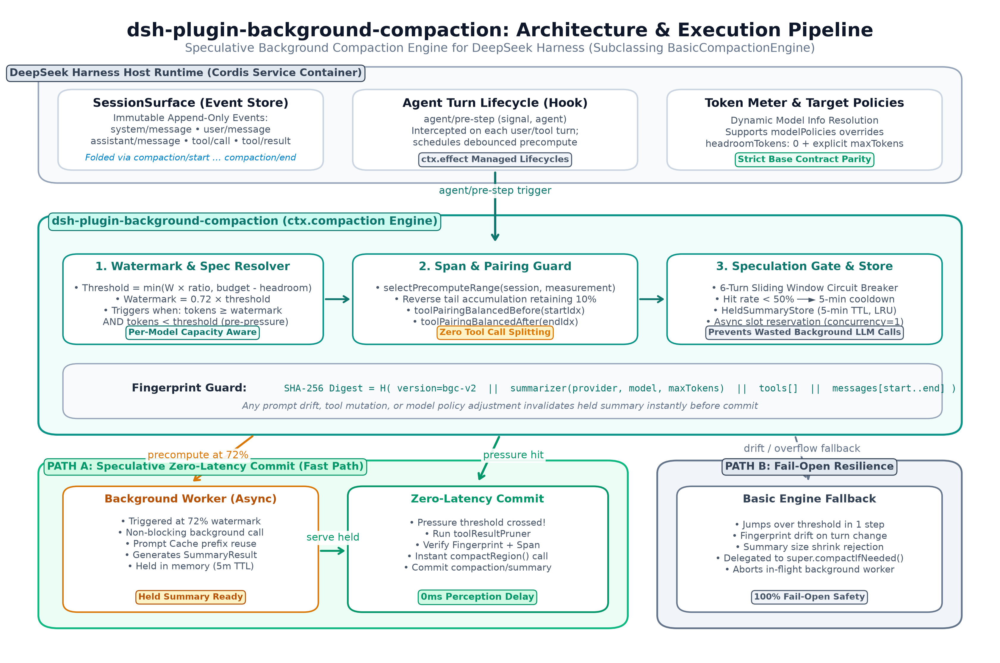

# dsh-plugin-background-compaction

Zero-latency context compaction for [DeepSeek Harness](https://github.com/deepseek-ai/deepseek-harness).

Stock compaction is **foreground**: the session reaches the pressure threshold and then waits
for a summarizer call while the user watches a spinner. This plugin moves that work **ahead of
time**. Once the conversation crosses a watermark it starts a speculative summary in the
background, holds the result, and when the hard threshold is reached it serves the held summary
instantly instead of calling the model.

The turn is frozen for **7 ms instead of 16 s** — measured, not estimated. See
[BENCHMARK.md](BENCHMARK.md) for the four-way comparison below and how to reproduce it.

## How it compares

Four compaction strategies exist in the DSH ecosystem today. They were run against an identical
16-document, ~49 K-token read-and-recall task in the same harness, with the same model and the same
trigger point (36,000 tokens). Three runs per arm, median shown.

| arm | strategy | blocking | wall clock | billed in / out | facts kept |
| --- | --- | ---: | ---: | ---: | :---: |
| A | stock `compaction-basic` | **16.1 s** | 95.9 s | 150,978 / 1,024 | 3/3 |
| B | `tool-result-pruner` + `compaction-basic` | **15.3 s** | 94.9 s | 158,196 / 1,021 | 3/3 |
| C | [`@aiwayds/dsh-dcp`](https://github.com/fan56/dsh-dcp) (zero-LLM) | **12 ms** | 118.4 s | 199,068 / 529 | 3/3 |
| D | **this plugin** | **7 ms** | 90.4 s | 154,249 / 983 | 3/3 |

### Where this plugin actually wins

- **The stall disappears.** 16,095 ms → 7 ms is 99.96% of the wait removed. Pruning tool output
  first (arm B) buys only ~5%, because the cost is the model round trip, not the payload size.
- **The summary is still semantic.** Unlike rule-based compaction, the checkpoint is written by the
  model and can decide what mattered.
- **It is nearly free.** Speculation costs **+2.2% billed input** and **+1.5% cached input** over
  stock, because the foreground commit reuses the exact cache prefix the background call warmed.
- **It fails open.** Every failure path degrades to a single stock foreground pass, never to a
  corrupt session.

### Where it loses, and to what

- **It is not the fastest thing available.** `dsh-dcp` is within measurement noise (12 ms vs 7 ms).
  Anyone optimising purely for blocking latency can get the same result with zero token cost.
  This plugin trades a small, measurable token overhead for a *better summary*, not for a lower
  number.
- **It costs tokens that a deterministic compactor does not.** +2.2% input versus arm A, versus
  arm C's zero background cost. On a pay-per-token budget with a cheap model, dsh-dcp is the
  rational choice.
- **It can waste a background call.** The base engine's `toolResultPruner` rewrites the surface
  between precompute and commit, which invalidates the pinned span; the plugin detects this,
  books a miss, and re-precomputes. Observed in 2 of 3 runs. Correct behaviour, but a real cost.
- **Its advantage is conditional on the watermark being reached.** A single step that jumps past
  the threshold skips the arming window entirely and the run falls back to foreground behaviour —
  identical to stock.
- **Fidelity is not proven better.** All four arms reproduced every fact in every run. This
  benchmark does not establish that model-written checkpoints are more faithful than rule-based
  ones; it would take a many-compaction workload to separate them.
- **It replaces `compaction-basic`.** `ctx.compaction` is a single service, so it cannot run
  alongside it. It *is* the compaction engine, not a companion to it.

Read the full analysis, including the wasted-call trace and the threats to validity, in
[BENCHMARK.md](BENCHMARK.md).

## Architecture & How it works

The plugin is a **replacement for `compaction-basic`**, not a side-car. DSH mounts exactly one
`CompactionEngine` as `ctx.compaction`, so a plugin that wants to influence compaction has to be
that service.



```
                       watermark (threshold x 0.72)
conversation ───────────┬──────────────────────────┬─────────────►
                        │                          │
              speculative summarize          threshold reached
              (off the critical path)                │
                        │                             ▼
                        └──► HELD summary ──► summarize() serves it
                                             (0 ms, no model call)
```

| phase | what runs | user-visible latency |
| --- | --- | --- |
| below watermark | nothing | — |
| crossing the watermark | `super.summarize()` on the pinned span in the background | 0 ms added |
| at the threshold | optional `toolResultPruner` pass → pre-verified held `SummaryResult` committed via `compactRegion()` | one event loop tick |

Everything else stays with the framework. `BasicCompactionEngine` still owns span validation,
tool-pairing balance, `toolResultPruner` coordination, the `compaction/start` + `compaction/end`
durability markers, the shrink check (`framedSummaryTokens < shadowedTokens`), the
`SurfaceChangedError` freshness guard, and the surface fold.

### Why the span is pinned early

`compactRegion(start, end)` re-derives the summarization payload from immutable surface seqs
before calling `summarize()`, so a summary computed for span `8..21` matches byte-for-byte when
the foreground later commits that same pinned span. `fingerprintSummarizationInput()` (SHA-256
over the system head, shadowed messages, tool definitions, and effective summarizer target
`{ provider, model, maxTokens }`) is verified **before** `compactRegion()` starts: if anything
drifted, the held entry is dropped, the miss is booked against the circuit breaker, and the
engine delegates directly to a single stock `super.compactIfNeeded()` pass.

### Fail-open by construction

Every failure degrades to a single stock `compaction-basic` pass:

- below threshold (even while holding a summary) → delegates to `super.compactIfNeeded()`
- `toolResultPruner` brings tokens back below threshold → compaction skipped, intact held summary kept
- payload/model drift, expired TTL, or `compactRegion` rejection → held entry dropped, miss booked, single `super.compactIfNeeded()` pass
- foreground compaction starts while background precompute is in flight → background call aborted immediately
- `auto: false` or `enabled: false` → zero background listeners registered; behaves identically to `BasicCompactionEngine`

## Install

```bash
dsh plugin --profile <profile> add <path-to-this-package>
```

`package.json` declares `@deepseek-ai/dsh-compaction` and `@deepseek-ai/dsh-compaction-basic`
(`0.2.1-rc.5`) as **peerDependencies**. That declaration is load-bearing: DSH's boot-time module
interception (`routeLinked` in `dsh-app-boot`) routes a linked plugin's `@deepseek-ai/*` imports
to the copy bundled in the running `app.asar` only when the package name appears in the plugin's
own `peerDependencies`.

Configuration goes through `cordis.patch.yml`. The bundled patch disables `compaction-basic` and
inserts this engine while leaving `BasicCompactionEngine`'s own stock defaults untouched:

```yaml
- id: compaction-basic
  disabled: true

- insert:
    - id: background-compaction
      name: dsh-plugin-background-compaction
      config:
        enabled: true
        precomputeAtRatio: 0.72
```

## Configuration

Base engine keys (`thresholdRatio`, `headroomTokens`, `retainRatio`, `retainTokens`,
`summarizationProvider`, `summarizationModel`, `maxTokens`, `compactionRetries`,
`maxOverflowRetries`, `modelPolicies`, `auto`) are forwarded verbatim to `BasicCompactionEngine`;
background keys are consumed by this plugin and stripped before `super()` (the base validates an
exact key allowlist and throws on unknown keys).

| key | default | meaning |
| --- | --- | --- |
| `thresholdRatio` | `0.8` | base: fraction of `contextWindow` that triggers compaction (clamped by `messageBudget - headroomTokens`) |
| `headroomTokens` | `65536` | base: reserved room below `messageBudget` (`0` is allowed when `maxTokens` is explicitly positive) |
| `retainRatio` / `retainTokens` | `0.16` | base: recent tail budget retained verbatim |
| `maxTokens` | `headroomTokens` | base: output cap for the summarizer |
| `modelPolicies` | `[]` | base: per-`{ provider, model }` overrides |
| `auto` | `true` | base: register automatic compaction & background speculation |
| `enabled` | `true` | this plugin: master switch (`false` = pure stock `compaction-basic`) |
| `precomputeAtRatio` | `0.72` | fraction of `thresholdTokens` that arms background speculation |
| `minShadowTokens` | `2000` | do not speculate on spans smaller than this |
| `heldTtlMs` | `300000` | how long a held summary stays valid (ms) |
| `debounceMs` | `1500` | quiet period before speculation starts (ms) |
| `maxConcurrent` | `1` | concurrent background summarizer calls across all sessions |
| `maxSessions` | `64` | held-summary session cap (oldest evicted) |
| `gateEnabled` | `true` | enable the sliding-window hit-rate circuit breaker |
| `gateWindow` | `6` | number of recent settled speculations evaluated by the breaker |
| `gateMinHitRate` | `0.5` | minimum hit rate over `gateWindow` required to stay open |
| `gateCooldownMs` | `300000` | pause duration (ms) when window hit rate drops below `gateMinHitRate` |
| `trace` | `false` | emit `[bgc]` diagnostics (`DBG_BGC=1` in the environment enables this too) |

## Verification

```bash
pnpm exec tsc --noEmit     # 0 errors
node scripts/build.mjs     # ESM (lib/index.js) + .d.ts
node scripts/test.mjs      # 63 tests, 8 suites, 63 pass
```

End-to-end evidence inside a real `dsh --profile bc-headless` process is recorded in
[SANDBOX-REPORT.md](SANDBOX-REPORT.md): `modelPolicies` and `headroomTokens: 0` resolve in
lockstep with `BasicCompactionEngine`, precompute fires at the watermark, the held summary is
served at the threshold, and the base engine commits a `compaction/summary` transaction.

## Limitations

- **A background call can be wasted.** When `toolResultPruner` rewrites the surface between
  precompute and commit, the pinned span no longer matches, the held summary is dropped and booked
  as a miss, and a fresh one is computed. Observed in 2 of 3 benchmark runs. Correct behaviour, but
  it costs one extra background summarization.
- **Tokens are spent to buy latency.** +2.2% billed input versus stock compaction in the benchmark.
  On a strict pay-per-token budget a deterministic compactor such as
  [`dsh-dcp`](https://github.com/fan56/dsh-dcp) is cheaper.
- **Headless re-injection.** The headless runner re-appends the full prompt package after a
  surface fold, which consumes most of the tokens a compaction just saved. Interactive sessions
  do not do this.
- **Late speculation.** If a single step jumps past the threshold, the arming window is skipped
  and the plugin degrades to stock behaviour. It never speculates while already at pressure.
- **One engine per context.** Because `ctx.compaction` is single-implementation, this plugin
  cannot run beside `compaction-basic`; it replaces it.
