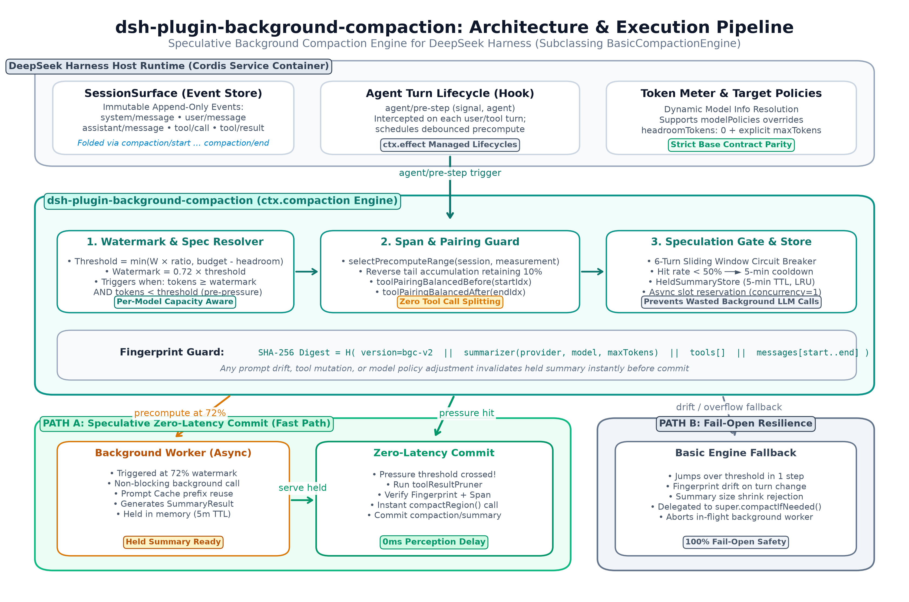

# dsh-plugin-background-compaction

[English](README.md) · **简体中文**

为 [DeepSeek Harness](https://github.com/deepseek-ai/deepseek-harness) 提供**零等待**的上下文压缩。

原生压缩是**前台阻塞**的：会话撞到压力阈值，然后你盯着转圈等一次摘要模型调用。这个插件把这件事
**提前做掉**——对话越过水位线后，它在后台先算好摘要并持有；等真正的阈值到来时，直接交出持有摘要，
不再调用模型。

在同一份 16 份文档 / 约 49K token 的测试任务上实测：回合被冻结的时长从 **16,095 ms 降到 7 ms**。
数据可以自己复现，脚本在 [`benchmark/`](benchmark/)，完整分析在 [BENCHMARK.md](BENCHMARK.md)。

---

## 为什么选这个

DSH 生态里每一种压缩策略，打的其实是不同的靶子。下面这几条是这个插件做到了、而其他方案没有做的部分。

### 1. 它把卡顿彻底拿掉——99.96% 的那种

| | 原生 `compaction-basic` | 本插件 |
| --- | ---: | ---: |
| 压缩期间回合冻结时长 | **16,095 ms** | **7 ms** |
| 单次最长阻塞 | 16.1 s | 7 ms |

约 2,300 倍。这个数字不是估的：它是从会话事件日志里读出来的
`compaction/end.time − compaction/start.time`，三次运行取中位数。基类引擎在构建摘要输入**之前**
就写下了 `compaction/start`，所以这个区间就是回合被卡住的真实时长。

### 2. 裁剪工具输出解决不了这个问题——数据已经证明了

`tool-result-pruner` 通常是大家最先打开的插件，它也确实有用。但它裁的是**载荷**，而成本不在载荷上。
打开裁剪后，阻塞从 16.1 s 降到 15.3 s——**只改善 5%**。因为那 15 秒是一次模型往返，不是你发过去的
内容有多大。

这个插件跟裁剪器不抢活，它**调用**裁剪器：提交前先跑一遍 `toolResultPruner`，两层叠加。裁剪让压缩
更便宜，后台预计算让压缩看不见。

### 3. 你拿到的是一份真正的摘要，而不是规则引擎的产物

最强的对手是 [`@aiwayds/dsh-dcp`](https://github.com/fan56/dsh-dcp)。它做得很好——同样是
`BasicCompactionEngine` 子类，同样的触发与提交流程，只是把 LLM 摘要器换成了确定性的规则摘要器。
在延迟上它和本插件打平（12 ms vs 7 ms，属于噪声级别）。

它做不到的是**判断什么才重要**。规则摘要器会把标识符、路径、命令、错误栈逐字保留；但把它们串起来的
那段话、一条决策背后的理由、后来某一步要依赖的半截推理——那是模型干的活。本插件付一点点 token
成本，就是为了留住这些。

| | 确定性压缩（`dsh-dcp`） | 本插件 |
| --- | --- | --- |
| 摘要由谁生成 | 规则 | 模型 |
| 能否压缩语义 | 不能 | 能 |
| 后台 token 成本 | 零 | 约 2%（缓存摊薄后） |
| 失效表现 | 丢掉所有规则没覆盖的含义 | 回退到前台压缩 |

### 4. 投机只多花 2%，不是翻倍

对"调两次模型"最直接的质疑是账单翻倍。并没有：

| 对比原生 | 变化 |
| --- | ---: |
| 计费输入 | **+2.2%** |
| 缓存输入 | **+1.5%** |
| 输出 | **−4.0%** |

后台调用和最终提交共用同一段 prompt 前缀，所以投机那一次几乎全程命中已预热的缓存。这是整个插件
最硬的一条设计约束——"钉住 span"存在的意义就是保证两次调用落进同一个缓存条目——而基准测试存在的
意义就是证明它在真实环境里确实成立。

### 5. 它不可能把你的会话搞坏

每一条失败路径都会退化成一次原生 `compaction-basic` 压缩，而不是退化成一具坏掉的会话：指纹漂移、
TTL 过期、裁剪器改写了 surface、提交被拒、前台抢先接管、`auto: false`。最坏情况就是"和原生一样"。
这个插件不会留下任何宿主读不懂的状态。

### 成绩单

四套策略、同一个 harness、同一个模型、同一个 36,000 token 触发点，各跑三次取中位数。

| 组 | 策略 | 阻塞 | 整体耗时 | 计费输入 / 输出 | 事实保留 |
| --- | --- | ---: | ---: | ---: | :---: |
| A | 原生 `compaction-basic` | **16.1 s** | 95.9 s | 150,978 / 1,024 | 3/3 |
| B | `tool-result-pruner` + `compaction-basic` | **15.3 s** | 94.9 s | 158,196 / 1,021 | 3/3 |
| C | [`dsh-dcp`](https://github.com/fan56/dsh-dcp)（零 LLM） | **12 ms** | 118.4 s | 199,068 / 529 | 3/3 |
| D | **本插件** | **7 ms** | 90.4 s | 154,249 / 983 | 3/3 |

### 什么时候该选别的

把丑话说在前面，比让你踩坑便宜：

- **纯粹为了省钱、模型也便宜** → 用 `dsh-dcp`。它一样不阻塞，且后台零 token 成本。
- **你连一次额外的模型调用都匀不出来** → 还是 `dsh-dcp`，或者只打开 `tool-result-pruner`，
  接受一个更小的收益。
- **保真度是你的硬指标** → 不要相信**任何**压缩策略，包括这个。四组在这个基准里都把事实全保住了，
  那只说明这个 workload 分辨不出来，不代表压缩无损。

其余内容——包括那次被浪费的后台调用的完整追踪、效度威胁、以及怎么重跑——都在
[BENCHMARK.md](BENCHMARK.md)。

---

## 架构与工作原理

这个插件是 `compaction-basic` 的**替代品**，不是旁挂组件。DSH 只把唯一一个 `CompactionEngine`
挂载为 `ctx.compaction`，所以想影响压缩的插件必须**成为**那个服务。



```
                       水位线（threshold × 0.72）
对话 ───────────────────┬──────────────────────────┬─────────────►
                        │                          │
              后台投机生成摘要                 到达阈值
              （不在关键路径上）                    │
                        │                          ▼
                        └──► 持有摘要 ──► summarize() 直接交出
                                          （0 ms，无模型调用）
```

| 阶段 | 发生什么 | 用户可见延迟 |
| --- | --- | --- |
| 水位线以下 | 什么都不做 | — |
| 越过水位线 | 在后台对钉住的 span 调用 `super.summarize()` | 0 ms |
| 到达阈值 | 可选跑一遍 `toolResultPruner` → 经 `compactRegion()` 提交已校验的持有 `SummaryResult` | 一个事件循环 tick |

其余一切仍归框架所有。`BasicCompactionEngine` 继续负责 span 校验、工具配对平衡、
`toolResultPruner` 协调、`compaction/start` + `compaction/end` 持久化标记、体积收缩校验
（`framedSummaryTokens < shadowedTokens`）、`SurfaceChangedError` 新鲜度守卫，以及 surface 折叠。

### 为什么必须提前钉住 span

`compactRegion(start, end)` 在被调用时会**从不可变的 surface 序号重新推导**摘要输入。所以针对
span `8..21` 算出来的摘要，等到前台真正提交同一段钉住的 span 时，仍然逐字节一致。

`fingerprintSummarizationInput()`（对系统头部、被遮蔽的消息、工具定义，以及生效的摘要目标
`{ provider, model, maxTokens }` 做 SHA-256）会在 `compactRegion()` **开始之前**校验：一旦发现任何
漂移，就丢弃持有项、记一次 miss 计入熔断器，并直接委托给一次原生的 `super.compactIfNeeded()`。

### 天生 fail-open

每条失败路径都退化为一次原生 `compaction-basic` 压缩：

- 未达阈值（即使手里持有摘要）→ 委托 `super.compactIfNeeded()`
- `toolResultPruner` 把 token 压回阈值以下 → 跳过压缩，保留完好的持有摘要
- 载荷/模型漂移、TTL 过期、`compactRegion` 拒绝 → 丢弃持有项、记 miss、走一次原生 `super.compactIfNeeded()`
- 前台压缩启动时后台预计算仍在途 → 立即中止后台调用
- `auto: false` 或 `enabled: false` → 不注册任何后台监听，行为与 `BasicCompactionEngine` 完全一致

## 安装

```bash
dsh plugin --profile <profile> add <path-to-this-package>
```

`package.json` 把 `@deepseek-ai/dsh-compaction` 与 `@deepseek-ai/dsh-compaction-basic`
（`0.2.1-rc.5`）声明为 **peerDependencies**。这个声明是承重的：DSH 在启动期的模块拦截
（`dsh-app-boot` 里的 `routeLinked`）只有在包名出现在插件自己的 `peerDependencies` 里时，才会把
链接插件的 `@deepseek-ai/*` 导入路由到运行中 `app.asar` 内置的那一份。

配置通过 `cordis.patch.yml`。随包附带的 patch 会禁用 `compaction-basic` 并插入本引擎，同时不改动
`BasicCompactionEngine` 自己的原生默认值：

```yaml
- id: compaction-basic
  disabled: true

- insert:
    - id: background-compaction
      name: dsh-plugin-background-compaction
      config:
        enabled: true
        precomputeAtRatio: 0.72
```

## 配置

基类引擎的键（`thresholdRatio`、`headroomTokens`、`retainRatio`、`retainTokens`、
`summarizationProvider`、`summarizationModel`、`maxTokens`、`compactionRetries`、
`maxOverflowRetries`、`modelPolicies`、`auto`）原样透传给 `BasicCompactionEngine`；后台相关的键
由本插件消费，并在调用 `super()` 之前剥离（基类会校验严格的键白名单，遇到未知键直接抛错）。

| 键 | 默认值 | 含义 |
| --- | --- | --- |
| `thresholdRatio` | `0.8` | 基类：触发压缩的 `contextWindow` 比例（受 `messageBudget - headroomTokens` 夹紧） |
| `headroomTokens` | `65536` | 基类：在 `messageBudget` 下方预留的空间（`maxTokens` 显式为正时允许为 `0`） |
| `retainRatio` / `retainTokens` | `0.16` | 基类：逐字保留的尾部预算 |
| `maxTokens` | `headroomTokens` | 基类：摘要器的输出上限 |
| `modelPolicies` | `[]` | 基类：按 `{ provider, model }` 的覆盖项 |
| `auto` | `true` | 基类：注册自动压缩与后台投机 |
| `enabled` | `true` | 本插件：总开关（`false` = 纯原生 `compaction-basic`） |
| `precomputeAtRatio` | `0.72` | 触发后台投机的水位线（占 `thresholdTokens` 的比例） |
| `minShadowTokens` | `2000` | 小于此值的 span 不做投机 |
| `heldTtlMs` | `300000` | 持有摘要的有效期（毫秒） |
| `debounceMs` | `1500` | 投机开始前的静默期（毫秒） |
| `maxConcurrent` | `1` | 所有会话合计的后台摘要并发上限 |
| `maxSessions` | `64` | 持有摘要的会话上限（最旧的被淘汰） |
| `gateEnabled` | `true` | 启用滑窗命中率熔断器 |
| `gateWindow` | `6` | 熔断器评估的最近投机结算数 |
| `gateMinHitRate` | `0.5` | 保持开启所需的最低命中率 |
| `gateCooldownMs` | `300000` | 命中率低于阈值后的暂停时长（毫秒） |
| `trace` | `false` | 输出 `[bgc]` 诊断日志（环境变量 `DBG_BGC=1` 亦可开启） |

## 验证

```bash
pnpm exec tsc --noEmit     # 0 errors
node scripts/build.mjs     # ESM (lib/index.js) + .d.ts
node scripts/test.mjs      # 63 tests，8 个套件，63 通过
```

真实 `dsh --profile bc-headless` 进程内的端到端证据记录在
[SANDBOX-REPORT.md](SANDBOX-REPORT.md)：`modelPolicies` 与 `headroomTokens: 0` 与
`BasicCompactionEngine` 同步解析，水位线处触发预计算，阈值处交出持有摘要，基类提交
`compaction/summary` 事务。

跨策略证据在 [BENCHMARK.md](BENCHMARK.md)，可从 [`benchmark/`](benchmark/) 复现。

## 已知限制

- **后台调用可能被浪费。** 当 `toolResultPruner` 在预计算与提交之间改写了 surface，钉住的 span 就
  不再匹配，持有摘要被丢弃并记一次 miss，然后重新计算。三次基准里有两次发生。行为是对的，但确实
  多花一次后台摘要。
- **用 token 换延迟。** 基准中比原生压缩多 2.2% 计费输入。严格按 token 计费时，确定性压缩器
  [`dsh-dcp`](https://github.com/fan56/dsh-dcp) 更便宜。
- **headless 会重新注入。** headless runner 在 surface 折叠后会重新追加完整提示包，把压缩刚省下的
  token 吃掉大半。交互式会话不会这样。
- **投机太晚。** 如果单步直接跨过阈值，准备窗口被跳过，插件退化为原生行为。它从不在已经处于压力
  之上时投机。
- **一个上下文只有一个引擎。** 因为 `ctx.compaction` 是单实现，本插件无法与 `compaction-basic`
  共存——它替换它。

## 技术贡献

**1. 提前钉住 span。** 预计算摘要最直觉的做法——"把目前为止的对话摘要一下，之后再拼进去"——是行不通
的，因为前台引擎是**在触发的瞬间**才挑选压缩 span 的，而那时尾部通常又长了一截。
`compactRegion(start, end)` 从不可变的 surface 序号重新推导输入，所以针对 span `8..17` 算出的摘要，
在稍后提交同一段 span 时仍然逐字节一致。投机之所以可行，只因为 span 是按序号钉住的，而不是按 token 数。

**2. 指纹守卫的提交。** 在把前台调用花在持有摘要上之前，插件会重新计算一个 SHA-256：覆盖系统头部、
被遮蔽的消息、工具定义**以及生效的摘要目标** `{ provider, model, maxTokens }`，并与预计算时记录的
值比对。不匹配就丢弃该项并委托一次原生压缩，于是过期预测的代价是零，而不是双倍。

**3. 把缓存前缀复用当成设计约束。** 后台调用与最终提交共用同一段 prompt 前缀，这就是投机只多花
**2.2% 计费输入**、而不是让账单翻倍的原因。钉住 span 的设计目的就是保证两次调用落到同一个缓存条目；
基准存在的目的就是证明这一点成立。

**4. 能安全失效的预测记账。** 只有在 `compactRegion` 真正解析成功后才会记命中，绝不会在"把摘要交出去"
时就记。滑窗命中率熔断器会在预测持续失准时暂停投机，而不是一直烧 token。

**5. 天生 fail-open。** 每一条失败路径——漂移、过期、裁剪器改写 surface、提交被拒、前台接管、
`auto: false`——都退化为一次原生 `compactIfNeeded()`。这个插件可能比原生慢，但它不可能搞坏会话。

**6. 一份测量，而不是一句声明。** 阻塞延迟被定义为会话事件日志中 `compaction/start` ..
`compaction/end` 的区间，也就是回合被冻结的那段窗口。正是这个指标产出了 [BENCHMARK.md](BENCHMARK.md)
里的数字——包括那些对本插件不利的数字。

## 致谢

这个插件站在 [OpenCode](https://github.com/sst/opencode) 的肩膀上。**后台压缩**这个思路——在阈值
之前先算好摘要、持有它、等压力真正到来时再换上去——来自 OpenCode 在「提前生成压缩摘要」上的工作，
以及它对「持有摘要 + prompt 缓存」的处理方式。这个设计是本插件存在的全部理由；这里的一切都是把这个
想法移植到 DSH 的 `CompactionEngine` 模型上——在 DSH 里，`compaction/start` + `compaction/end`
持久化标记和事件溯源式的会话 surface，让"钉住"这件事的形态与一个只存消息数组的会话完全不同。

同样需要感谢：

- [`@aiwayds/dsh-dcp`](https://github.com/fan56/dsh-dcp)，它遵循 Opencode-DCP，展示了确定性、
  零 LLM 的路线。它是本插件在成本上打不过的那一组；正因为拿它做对照，这份 README 才没法自吹。
- `@deepseek-ai/dsh-compaction-basic`，把 `summarize()` 和 `compactRegion()` 留作扩展面，而不是把
  压缩封在一个只能整体替换的接口后面。
- 那些在插件注册表与上下文管理上做了大量工作的 DSH 插件作者——是他们让这个生态变得可被度量。

## 许可

MIT
